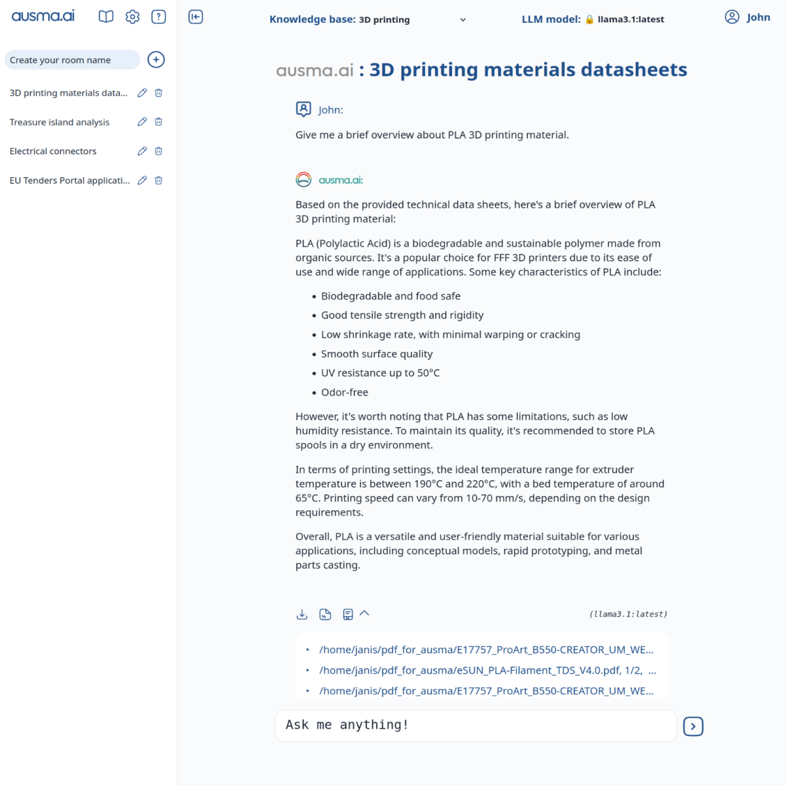

# Ausma.ai Documents

## Summary

Ausma.ai Documents is a locally hosted chatbot application for working with documents using LLMs (Large Language Models).

This tool was developed by ["V-Industries" SIA](https://v-industries.lv/en) for internal use before it was published to open source. It is actively being developed and major parts of it may be subject to change.

Homepage: <https://ausma.ai>



## Features

- Locally hosted - data does not leave your machine
- More than traditional text search - use RAG (Retrieval Augmented Generation) to get more context-relevant results and gain better insights on your prompts
- Document ingestion pipeline
  - Supports .pdf, .md, .txt formats.
  - Supports email loading (experimental)
- Customizable chatbot - use your preferred LLM for chatting.
- Default LLM runner (Ollama) - a locally deployed AI model runner. Features automatic setup for use with AMD and NVIDIA cards as well as running on CPU.
- User friendly web-interface
- Packaging - build and install the app yourself or run it as a project

### Coming soon:

- More document formats - presentation files, spreadsheets, etc.
- Scalability features for multi-user solutions and large datasets.

## Installation

### Dependencies

Ausma.ai Documents has been developed and tested under Ubuntu Server 24.04 LTS and latest Tuxedo OS. It may work on related operating systems.

#### Ubuntu

```bash
sudo apt install python3.12-venv poppler-utils tesseract-ocr libtesseract-dev
```

### Running from source

- Clone the repository:

```bash
git clone [gitrepo]
```

- Run the setup from the project directory:

```bash
cd ausma-ai-documents &&
./setup_linux.sh
```

## Quick start

- Run the web-app and open in browser (see the URL in terminal):

```bash
./run_app.sh
```
### \> For simple chat:

- Create a room
- Choose an installed model
- Start chatting!

### \> To use chatbot with your documents:

- Prepare an existing document folder on your machine
- Define your input document folder as a Document Source in Settings page
- Create a Knowledge Base in the Knowledge Base Settings page
  - More info in the docs: docs/HOWTO_knowledge_base.md
- Run the Knowledge Base Service to process your documents
  - This may take a while depending on document amount
- Create a room (think of a room as a session or a conversion)
- Join the room, by clicking it.
- Select knowledge base:
  - `None` - Same as the simple chat - no document context used.
  - `<knowledge base name>` - model uses RAG - receives relevant documents from vectorstore based on your query. This enhances the response with document aware context.
- Choose a LLM model from the installed models and you are ready to ask your questions. Note that the model gets locked-in for this room.

### More models and LLM runners:

#### Ollama

If you installed Ollama with the installation script, then you can get more models by installing them on your Ollama instance. For more information, visit: [ollama.com](https://ollama.com/)

You can also add other Ollama instances in the LLM Runners section of the Settings page. LLM Runners have a priority list - first one to be able to run the model gets used.

#### openai

If you prefer to use external service, you may also use openai API:

WARNING! : openai is a paid API. By using such AI inference services, you confirm that you take full responsibility for any costs that it may occur due to use or misuse of this project.

- In Settings page create an openai runner in the section LLM Runners
- Input credentials
- By default, an openai_models.json file is created with example models "gpt-4.1", "gpt-4.1-mini", "gpt-4.1-nano"
  - You can manually add or remove models to this list. Check with your account what models are available to you

#### Remote runner (experimental)

This is a runner that allows for custom AI implementations. For more information, see the docs: docs/HOWTO_remote_llm_runner.md

WARNING! : This option allows for custom wrapping of paid AI inference services. By using this, you confirm that you take full responsibility for any costs that it may occur due to use or misuse of this project.

- In Settings page create a remote runner in the section LLM Runners
- Fill out the fields and start using

### Examples

The "knowledge" of Ausma.ai depends on the loaded documents and the LLM model.

If you load the relevant computer manuals you may ask something like:

```
What are the supported memory configurations for Lenovo Thinkstation P520?
```

or

```
How many SATA drives can I plug into a Asrock X399 Phantom Gaming 6 motherboard?
```

If you load the relevant documents from the EU Funding and Tenders Portal, it makes sense to ask:

```
How do I register to be able to submit proposals for EU tenders?
```

It is better to be specific in your queries.

```
Give a detailed step by step instructions on how to register for EU Tenders portal to be able to submit proposals,
```

The answers get better given more context.

```
We are a small Latvian I software company. We want to submit our solution proposals related to Data processing for the European project tenders.
Give a detailed step by step instructions on how to register for EU Tenders portal to be able to submit proposals,
```

Afterwards you can ask Ausma to explain each step in more details. Do use the relevant keywords and expressions for better answers. Again more context is better.
Bad example:

```
Please explain step 4 in more detail.
```

Good example:

```
Please explain getting the PIC number in more detail (step 4).
```

## Trivia

"Ausma" is a Latvian word that may be translated as "dawn" or "early daylight". The name was chosen because it runs locally, not on the cloud. "If you get rid of clouds, you can see daylight."

## Acknowledgements

Special thanks to "Solar Icons". SVG Icons are used and modified under CC Attribution License. Link: [https://www.svgrepo.com/collection/solar-outline-icons/](https://www.svgrepo.com/collection/solar-outline-icons/)

## Disclaimer

Ausma.ai is an assistant, it is not a lawyer, doctor, electrician, engineer nor any other kind of specialist. LLM models may hallucinate - produce/invent incorrect results that may appear believable. Be critical of the answers provided. Consult an actual specialist when appropriate.

This project is provided as-is.
By downloading this project you agree to take responsibility for any possible use, misuse and results of this product.
